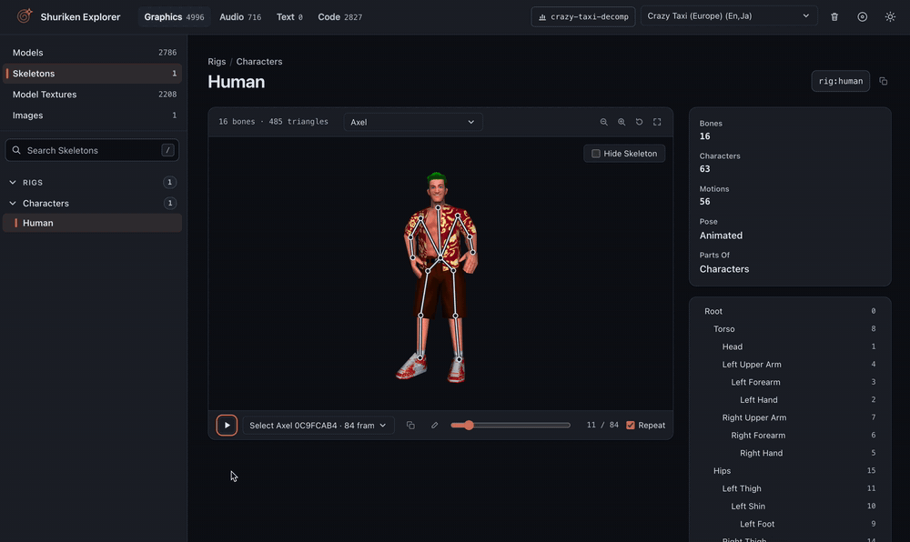
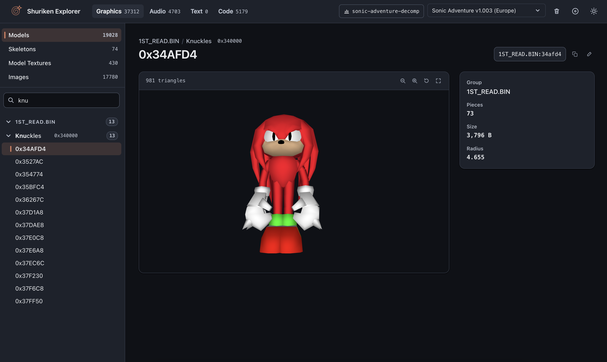
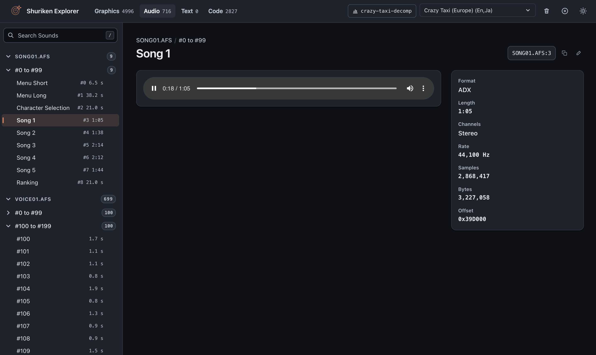
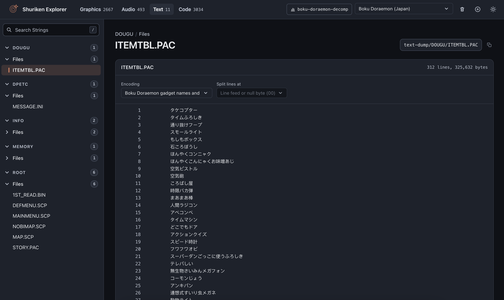
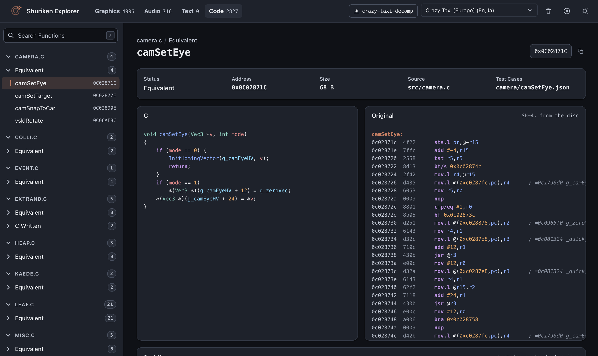

# dc-shuriken-explorer

**Open it in your browser: [consolesplayingconsoles.github.io/dc-shuriken-explorer](https://consolesplayingconsoles.github.io/dc-shuriken-explorer/)**

Browse a Sega Dreamcast game's models, skeletons, animations, textures, sounds and code in your browser.
You open your own copy of the game and it stays on your computer: nothing is uploaded.
A plain disc shows static assets; add the game's decomp and you also get assembled, textured and animated models 
as well as C and assembly code side by side. See the asset list below.

*An illustration of how the tool works: no game assets are stored in this repository.*

> A decomp is a reverse-engineering project for one game: its code rewritten function by function as C, and its files
mapped and named. [dc-decomp-kickoff](https://github.com/consolesplayingconsoles/dc-decomp-kickoff) starts one from
your own disc, and Shuriken Explorer reads what it produces. A decomp straight out of dc-decomp-kickoff already
shows much of the game's assets, with no decompiling needed.

Dissect your favourite game, mod it, translate it, build new games from it, but remember that the game's assets are
intellectual property and cannot be distributed or commercialised (this is not legal advice).

## Asset types

| Category | Kind           | What you get                                                             | Supported                                                |
|----------|----------------|--------------------------------------------------------------------------|----------------------------------------------------------|
| Graphics | Models         | 3D models, and characters assembled from their parts                     | Yes                                                      |
| Graphics | Skeletons      | Bones over the character, with its animations playing                    | Yes                                                      |
| Graphics | Model Textures | The textures models use                                                  | Yes                                                      |
| Graphics | Images         | Pictures: menus, sprites, portraits                                      | Yes                                                      |
| Audio    | Sounds         | Music and sound effects, played in the page                              | Partly: ADX and WAV are played; other formats are listed |
| Code     | Functions      | The game's functions, the C beside the disassembly, and their test cases | Yes                                                      |
| Text     | Strings        | The game's text                                                          | Japanese text only                                       |

## Supported formats

| Format                                                              | Used for                       | Needs a decomp?         | What is read                                                                                                                                             |
|---------------------------------------------------------------------|--------------------------------|-------------------------|----------------------------------------------------------------------------------------------------------------------------------------------------------|
| AHX streams, DTPK, SMLT and SMPB sound banks, STR sample streams    | Sounds                         | No                      | Listed, not played                                                                                                                                       |
| CRI ADX streams                                                     | Sounds                         | No                      | Played, in plain files and inside AFS archives                                                                                                           |
| GIF, JPEG and PNG files                                             | Images                         | No                      | Shown as they are                                                                                                                                        |
| NAOMI library models                                                | Models                         | No                      | The flat model format of the NAOMI library: records of PowerVR polygon words and strips                                                                  |
| Ninja chunk models                                                  | Models                         | No                      | Object trees with chunk models, stored as `NJCM` chunks, with the texture names of the `NJTL` chunk before them                                          |
| Ninja motions                                                       | Models                         | Yes                     | Position, angle, quaternion and scale keys (`NMDM`, `.NJM`), played on the skeleton they belong to                                                       |
| Ninja object trees stored as the game's memory image                | Models                         | No                      | Chunk models and basic models (points and meshsets of triangles, quads and strips), found by structure, in plain or PRS-compressed files                 |
| PowerVR2 textures (`PVR`, `PVM`, a `PVRT` chunk anywhere in a file) | Model textures, images         | Only for model textures | Twiddled, VQ, small VQ and rectangle, with or without mipmaps, in ARGB1555, RGB565, ARGB4444 or YUV422; palettised ones use the palette file beside them |
| PRS streams tagged `PRESSED`                                        | Models, model textures, images | Only for model textures | Each stream is read as a file of its own, named `file@offset`: the tag, then a size and a name, or the stream itself                                     |
| Quake 3 models (`MD3`)                                              | Models                         | No                      | Every surface of an `IDP3` version 15 model, in plain files and inside ZIP archives                                                                      |
| RAT archives                                                        | Sounds                         | No                      | Sound effects are listed, not played; the textures, sprites and models inside are not read yet                                                           |
| `PRM` mesh files                                                    | Models                         | No                      | One model per file: 16-bit polygon and vertex counts, 60-byte polygons (triangles and quads), 24-byte vertices; untextured                               |
| Sega PRS compression (`.PRS` files)                                 | Models, model textures, images | Only for model textures | Read through it: offsets are into the decompressed data                                                                                                  |
| SH-4 code                                                           | Functions                      | Yes                     | Disassembled in the page, from the decomp's function list                                                                                                |
| Tagged model blocks                                                 | Models                         | No                      | A count and a table of offsets, each body tagged with four letters and holding a node tree of mesh groups drawn from N64-style display lists; untextured |
| `TR4` level files                                                   | Models, images                 | No                      | One model per mesh of the level and one picture per texture page (32-bit and 16-bit), read through the file's zlib blocks; the meshes are untextured     |
| V-format and 16-bit Euler motions                                   | Skeletons                      | Yes                     | Animations from the decomp's skeleton rules                                                                                                              |
| WAV files                                                           | Sounds                         | No                      | Played; 4-bit ADPCM files (tag 0) are decoded as mono Yamaha ADPCM                                                                                       |
| ZIP archives                                                        | Models, images                 | No                      | Stored and deflated members are read as files of their own, named `file@offset`                                                                          |

Not read yet: GameCube-style models, Ninja motions that use anything but position, angle, quaternion and scale, bump
textures, and text.

## Plain disc or decomp

A plain disc is all you need to browse its static assets including models (not assembled, textured or animated). A dc-decomp-kickoff project adds the rest.

| What you get                                           | Plain disc                            | With the decomp                                    |
|--------------------------------------------------------|---------------------------------------|----------------------------------------------------|
| Models, grouped by disc file                           | Yes                                   | Yes                                                |
| Models drawn with their textures                       | No (own colours where they have them) | Yes                                                |
| Names, and models grouped by the tables that hold them | No                                    | Yes                                                |
| Assembled characters                                   | No                                    | Yes                                                |
| Skeletons                                              | No                                    | Yes, where the decomp has rig rules                |
| Model textures                                         | No                                    | Yes                                                |
| Images                                                 | Yes                                   | Yes                                                |
| Sounds                                                 | Yes                                   | Yes                                                |
| Code                                                   | No                                    | Yes                                                |
| Renaming (writes the decomp's `models.txt`)            | No                                    | Yes, in browsers with folder access (Chrome, Edge) |

The page reads `model-map/game.dcgs` and `models.txt` from the folder on every load, so what the decomp regenerates
or you edit is what shows. Browsers without folder access can open a `game.dcgs` for the session, with no renaming.

## Tested games

See [which games have been tried](GAMES.md), and which are known not to work.

Disassemble, explore and have fun. Please share your progress: it helps other decomps move forward, and it makes both
dc-decomp-kickoff and Shuriken Explorer stronger for everyone.

## Plugins

General formats and practices are shared when possible. Scans run on all games and are in sync with the dc-decomp-kickoff project. The sync is validated by pre-commit hooks.
Costly logic that applies to only one game must be stored in per-game plugins (see the [list of games](GAMES.md) for examples) to avoid an
infinitely growing load step.

## Screenshots

*Graphics: a character model from the Sonic Adventure decomp, textured, with the skeletons and images listed beside it.*

*Audio: a song playing from the Crazy Taxi decomp, with its format, rate and length.*

*Text: the gadget names of Boku Doraemon, read through its plugin.*

*Code: a function's C beside the original SH-4 disassembly, in the Crazy Taxi decomp.*

The images in this README are illustrations of how the tool works: no game assets are stored in this repository.

## See it in action

See what type of mods Shuriken can help create:

- 📸 **Instagram:** [@consolesplayingconsoles](https://www.instagram.com/consolesplayingconsoles/)
- 🔗 **Everything else:** [beacons.ai/consolesplayingconsoles](https://beacons.ai/consolesplayingconsoles)
